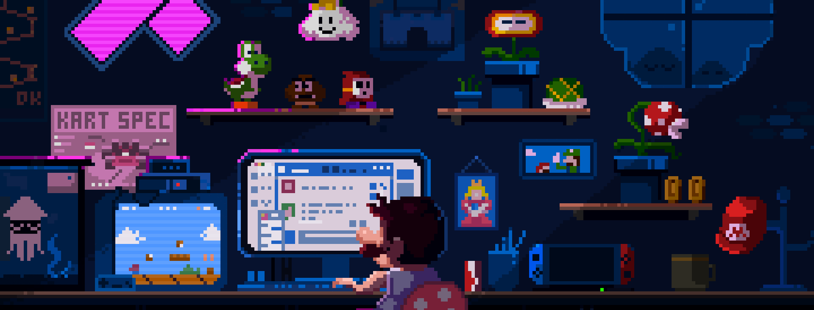

  

  # ⚡ Ashutosh Chandra
  **Senior Software Engineer | Full-Stack Architect | GenAI Enthusiast**

  

    
    
    
    
  

  ---

### 🧑‍💻 About Me
- 🔭 Currently architecting high-performance UI solutions and specialized component libraries.
- 💬 Ask me about **Vue, React, Nuxt, and Go**.
- 🤖 Deeply interested in **Agentic AI** and LLM integrations.
- ⚡ Fun fact: I am an Engineer who loves artisanal clay crafts.

---

### 🛠️ My Tech Stack

| Category | Tools & Technologies |
| :--- | :--- |
| **Frontend** |      |
| **Backend** |    |
| **Database** |    |
| **DevOps** |    |

---

### 📊 Github Stats

  
  

  

---

  
   
  Built with ❤️ by Ashutosh

